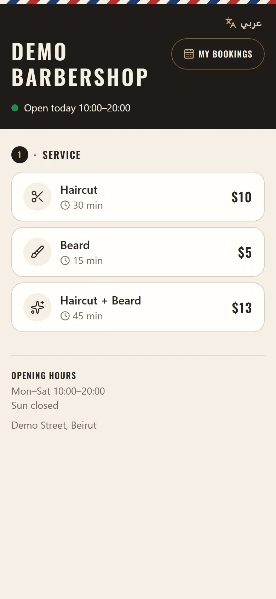
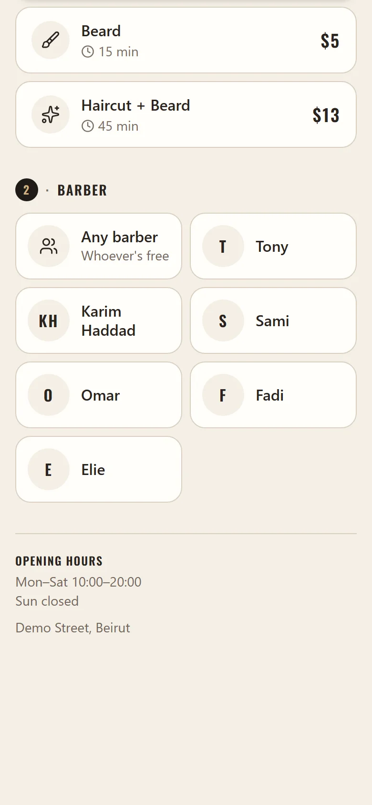
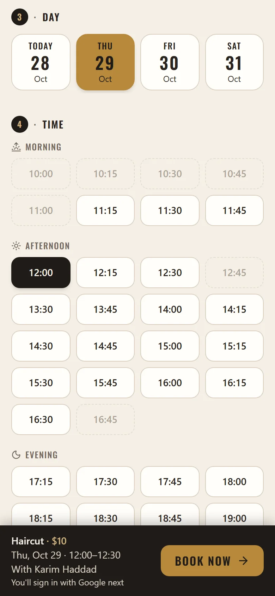
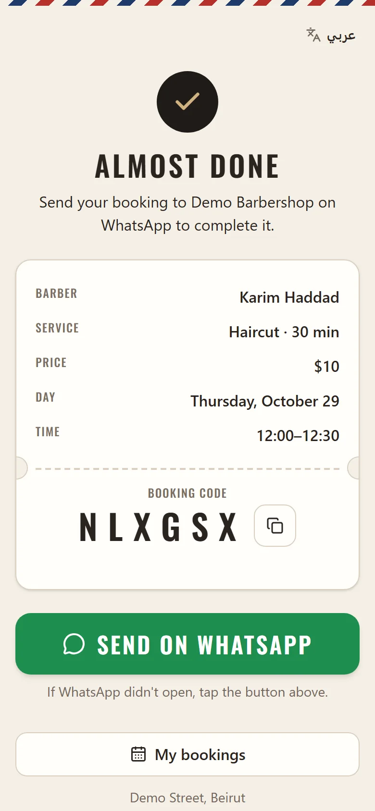
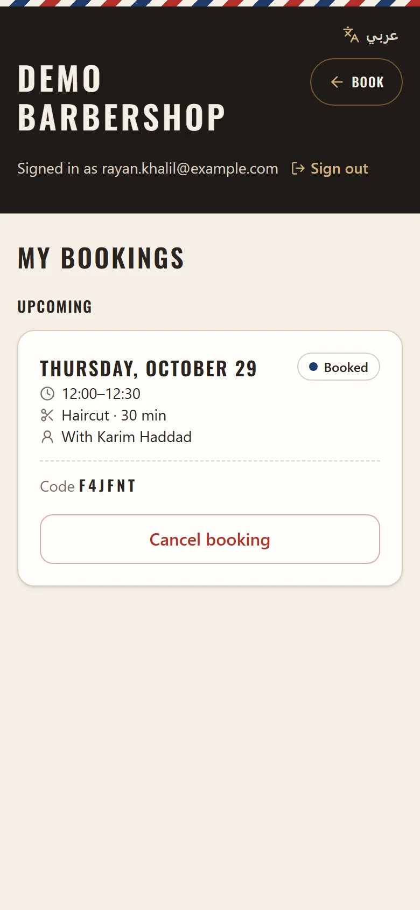
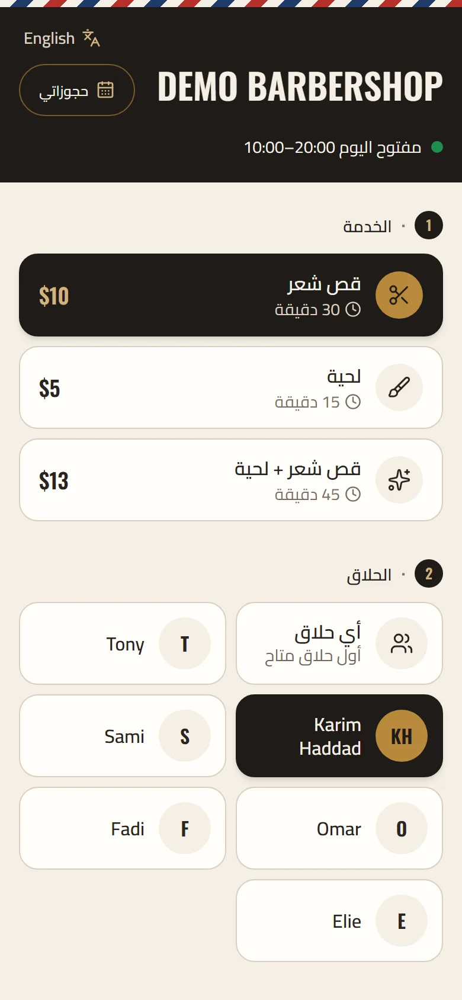
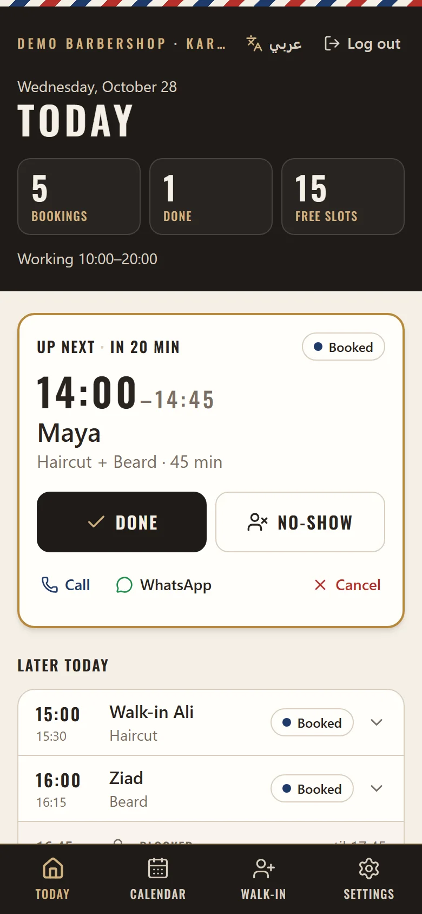
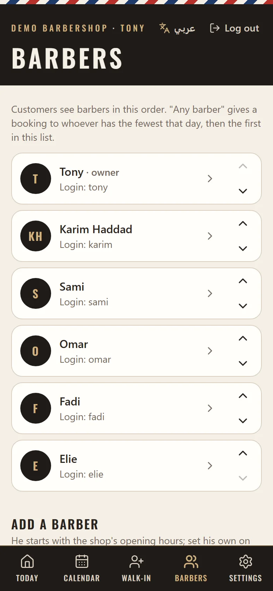
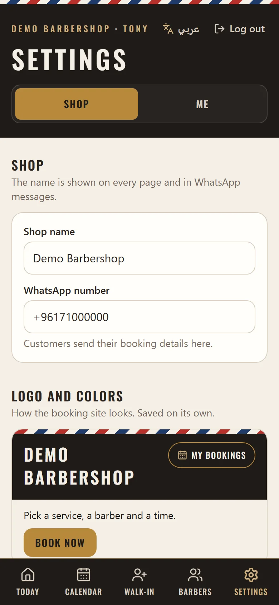
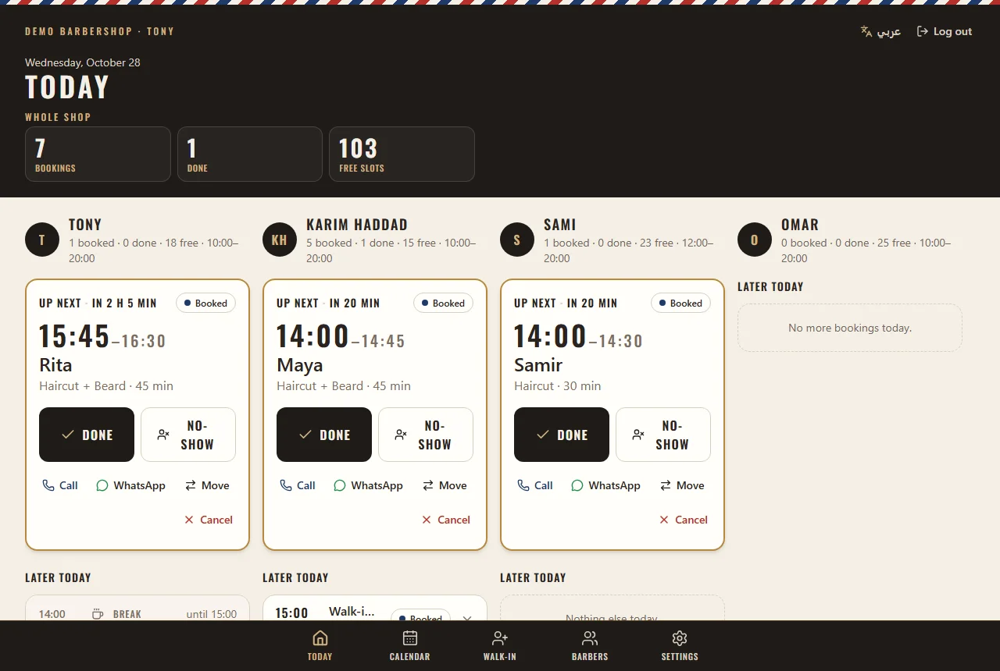

# Barbershop Booking — multi-barber, multi-shop

An online booking system for barbershops in Beirut, in English and Arabic. Customers pick a
service, a barber (or "any barber"), a day and a free time on their phone, sign in with Google,
and send the booking to the shop on WhatsApp. Each barber runs his own day from a mobile
dashboard; the owner also sees every barber's day, manages the team and their logins, and sets
the shop's hours, services, prices, logo and colors. Every rule (no double bookings, each
barber's hours, booking limits) is enforced on the server by Firestore security rules, not just
in the browser.

One codebase serves many shops: each shop is its own Firebase project with its own config in
`shops/<shop>/` (see [Adding a new shop](#adding-a-new-shop)).

## Screenshots

The demo shop on the local emulators (made-up barbers and customers). Regenerate them with
`npm run screenshots`.

**Customers**

<table>
  <tr>
    <td></td>
    <td></td>
    <td></td>
  </tr>
  <tr>
    <td align="center">Service</td>
    <td align="center">Barber or "Any barber"</td>
    <td align="center">Day and time</td>
  </tr>
  <tr>
    <td></td>
    <td></td>
    <td></td>
  </tr>
  <tr>
    <td align="center">Confirmation</td>
    <td align="center">My bookings</td>
    <td align="center">Arabic (right to left)</td>
  </tr>
</table>

**Barbers and owner**

<table>
  <tr>
    <td></td>
    <td></td>
    <td></td>
  </tr>
  <tr>
    <td align="center">Barber: Today</td>
    <td align="center">Owner: barbers</td>
    <td align="center">Owner: Settings → Shop</td>
  </tr>
</table>



<p align="center">Owner on a computer: every barber's day in columns</p>

## Features

**For customers**

- Services with duration and price, then a barber: a named one or "Any barber" (the first one
  free). Days within the booking window (closed days shown but not selectable), and start times
  grouped by morning, afternoon and evening, from that barber's own hours, breaks and days off.
- Live availability: times update in real time as other people book, and times that don't
  leave enough room for the chosen service are faded out.
- Google sign-in, then name and phone (remembered for next time).
- A confirmation "ticket" with a booking code, a pre-filled WhatsApp message to the shop, and
  directions.
- "My bookings" to see past and upcoming bookings and cancel before the appointment.
- English or Arabic, switched from any page and remembered on the device. Arabic is fully right
  to left with the Cairo font, Arabic month names and Arabic service names; phone numbers and
  booking codes stay left to right.

**For barbers**

- Their own login (a username and password). A "Today" dashboard: bookings, done and free-slot
  counts, the next customer with one-tap Done / No-show, call and WhatsApp links, and the rest
  of the day including breaks and blocked times.
- A calendar view of any day, and walk-in or phone bookings that go through the same
  double-booking checks as online ones.
- Their own weekly hours with breaks, days off and blocked times.

**For the owner** (also a barber)

- Every barber's day: the whole shop's numbers, one barber at a time on a phone, all of them in
  columns on a computer. Bookings can be moved to another barber.
- Barbers: add, reorder, turn off (their upcoming bookings are listed to move or cancel), and
  create or reset their logins.
- The shop: name, opening hours, closed days, services with prices and Arabic names, booking
  window and holiday periods, WhatsApp number, address and Maps link, logo and colors. Changes
  show up live on the booking page; nothing is ever cancelled automatically.

## Tech stack

- **Frontend:** React, TypeScript, Vite, Tailwind CSS (mobile-first), lucide icons, self-hosted
  Oswald font
- **Backend:** Firebase: Cloud Firestore (real-time data + security rules), Authentication
  (Google for customers, email/password for the barber), Hosting, App Check (reCAPTCHA
  Enterprise)
- **Testing:** Vitest, Firebase Local Emulator Suite, `@firebase/rules-unit-testing`

## How it works

**One shop, one Firebase project.** Every shop runs the same code and the same security rules in
its own free (Spark) Firebase project, so shops never share data, logins or quotas. A shop is a
folder in this repository (`shops/<shop>/`: its public web config, name and logo); the deploy
builds the site with that config and refuses a shop that isn't complete. Development and tests
only ever use the local emulators, on a `demo-` project that can't reach a real one.

**No double bookings, even under concurrent requests.** Each barber's day is one Firestore
document (`days/{barberId}_{date}`) with a map of taken 15-minute slots, and another of the times
he blocked. A booking is one transaction that writes the booking, its slots in that barber's day
and the customer's seats. The rules only let a booking *add* slot keys that weren't there, never
change one, so if two people grab the same barber and time at once, one write fails and nothing
partial is saved; the app then retries with fresh data. Different barbers are different
documents, so they never conflict. One document per barber per day also keeps the booking page
cheap: it listens to one document for a chosen barber, or one per barber for "Any barber".

**"Any barber".** The browser picks the barber who is free for the whole service and has the
fewest bookings that day, then the first in the owner's order. The rules don't re-check that
choice (it would cost a read per barber), but everything else is still enforced for the barber
picked: his hours, breaks and days off, and his free slots.

**All rules enforced server-side.** The page checks everything for a good experience, but the
Firestore security rules are what count. A customer booking must match the current settings: an
existing service with its exact name and length, an active barber under his current name, inside
both the shop's and that barber's hours, clear of his breaks, his days off and the shop's closed
days, in the future, inside the booking window (or a holiday period's), with only the expected
fields. Cancelling a booking must free exactly its slots, and moving one to another barber
(owner only) must take exactly the same slots in the new barber's day. Customers only see their
own bookings and can cancel them only before they start.

**Staff logins and roles.** Barbers log in with a username and password: each username maps to
an internal email/password account (on a `.invalid` domain, so nothing is ever mailed), and a
`staff/{uid}` record says which barber that login is and whether it's the owner. Each shop has
exactly one owner. A barber can read and change only his own bookings, hours and days off; the
owner can do everything, including creating logins for barbers from the dashboard, without being
signed out (a second, throw-away Firebase instance creates them). Turning a login off takes
effect at once, even for someone signed in. A forgotten password gets a "New login" with the
same username, since the free plan can't reset another user's password.

**Rules tuned to Firestore's limits.** Firestore stops evaluating a write after 1,000
expressions and 10 document reads. A customer booking reads 5 documents (shop settings, the
barber, his day and two seats). Data is stored in the shape that's cheapest to check (times as
minutes, dates as day numbers, services as a map, holiday windows expanded to a per-day lookup),
and no rule loops over map keys. Tests build the heaviest valid writes and re-run them against
padded copies of the rules, to prove a booking keeps about 30% of the expression budget spare,
and shop settings, adding a barber and moving a booking about 20%.

**Google sign-in with per-account limits.** Each Google account and each phone number can hold
at most 2 upcoming bookings across the shop, enforced with "seat" documents the rules check in
the same transaction, so the calendar can't be filled from one account. Customers sign in with
Google and staff with a password, and the rules tell them apart by the sign-in method.

**Hardened hosting.** A strict Content-Security-Policy (only the site's own scripts plus Google
sign-in, reCAPTCHA and the Arabic font), HSTS, `frame-ancestors` / X-Frame-Options, `nosniff`,
Referrer-Policy and Permissions-Policy, set in `firebase.json`. App Check limits the database to
the real website. User-provided links (the Maps link) must be `https://`, and the logo is a
small image checked by the rules, kept apart from the settings bookings read.

**Time zones.** Bookings are in the shop's time (Asia/Beirut, with daylight saving), whatever
the visitor's device says, and the rules check each booking's start instant against it.

## Testing

```bash
npm test             # Vitest: slot grid, availability, schedule, time zone and phone logic
npm run test:rules   # Firestore rules + data layer against the emulator (needs Java 21+)
```

The rules suite (140 tests) covers double booking (including several customers booking at once),
"Any barber", moving and cancelling, booking limits, every settings check, staff roles and
logins, who can read what, and the rules-limit margins above.

## Running locally

Requirements: Node.js 22+, the [Firebase CLI](https://firebase.google.com/docs/cli)
(`npm i -g firebase-tools`), and Java 21+ for the emulators. Everything runs against the local
Firebase emulators (project `demo-barbershop`), never a real project:

```bash
npm install
npm run emu       # terminal 1: Auth + Firestore emulators
npm run seed      # terminal 2: a demo shop: owner "tony" + 5 barbers, password "password1"
npm run dev       # http://localhost:5173 (customers), /admin (staff)
```

`npm run screenshots` retakes the pictures above (`docs/screenshots/`) with Playwright, from the
demo shop on the emulators (it starts its own if `npm run emu` isn't running). The first time,
install its browser: `npx playwright install chromium`.

Details, and click-through checklists for customers, barbers and the owner, are in
[docs/DEVELOPMENT.md](docs/DEVELOPMENT.md).

## Adding a new shop

Each shop is its own free (Spark) Firebase project, with the same code and the same security
rules. In this repository a shop is a folder `shops/<shop>/` (its `.env` and `logo.png`) plus an
alias in `.firebaserc`. The example below adds **sassine** in a project called
`sassine-maatouk`; use your own names. Eddy's project (`eddy-barbershop`) is locked until its
migration: every command here refuses it.

You need the Firebase CLI signed in with the Google account that will own the project
(`firebase login`), and Java 21+ (the deploy runs the emulator tests first).

### 1. Create the Firebase project

1. [console.firebase.google.com](https://console.firebase.google.com) → **Create a project**.
   Name it (e.g. "Sassine Maatouk"), and note the **project ID** it gets (e.g.
   `sassine-maatouk`). Google Analytics isn't needed. The project stays on the free Spark plan:
   nothing here needs billing.
2. **Project settings → General → Your apps → Web (`</>`)**: register a web app (any nickname;
   no need to tick Hosting there). Keep the `firebaseConfig` it shows for step 3.
3. **Build → Firestore Database → Create database**: production mode, and a location close to
   Lebanon (e.g. `eur3 (europe-west)`). The location can't be changed later.
4. **Build → Hosting → Get started**: click through (the deploy uploads the site).

### 2. Sign-in: providers, domains, Google

1. **Build → Authentication → Get started → Sign-in method**, enable:
   - **Email/Password** (not "Email link"): staff log in with it (a username on top).
   - **Google**: customers sign in with it. Set the public-facing name to the shop's name and
     pick the support email.
2. **Authentication → Settings**:
   - **User actions**: keep **Enable create (sign-up)** on. The owner creates barbers' logins
     from the dashboard with it; a login without a staff record gets no access.
   - **Authorized domains**: `localhost`, `<project-id>.firebaseapp.com` and
     `<project-id>.web.app` are there already. Add the shop's own domain if it has one.
3. Google's OAuth client, at [console.cloud.google.com](https://console.cloud.google.com) with
   the same project selected:
   - **APIs & Services → OAuth consent screen** (Google Auth Platform → Branding / Audience):
     app name = the shop's name, support email; under **Audience**, **Publish app** (in
     testing, only listed test users could sign in).
   - **APIs & Services → Credentials → OAuth 2.0 Client IDs → Web client (auto created by Google
     Service)**:
     - **Authorized JavaScript origins**: `https://<project-id>.web.app`,
       `https://<project-id>.firebaseapp.com`, and `https://<the shop's domain>` if any.
     - **Authorized redirect URIs**: the same addresses followed by `/__/auth/handler`, e.g.
       `https://sassine-maatouk.web.app/__/auth/handler`.

### 3. The shop's config in this repository

```bash
npm run new-shop -- sassine sassine-maatouk "Sassine Maatouk"
```

This creates `shops/sassine/.env` from `shops/_template/.env` and adds the alias
`sassine → sassine-maatouk` to `.firebaserc`. Then:

- In `shops/sassine/.env`, fill in every value still in `<angle brackets>` from the web app's
  config (step 1.2). `VITE_FIREBASE_AUTH_DOMAIN` and `VITE_SITE_URL` are the address customers
  open: `sassine-maatouk.web.app`, or the shop's own domain once it's connected.
  `VITE_SHOP_NAME` is the name the shop starts with (the owner changes it later in Settings →
  Shop) and the one link previews show.
- Add the shop's logo as `shops/sassine/logo.png`: the link-preview image (WhatsApp, Instagram),
  and the first logo if it's under 100 KB (otherwise the owner uploads it from the dashboard,
  which shrinks it).
- Commit both. The Firebase web config is public by design; the security rules protect the data.

### 4. The admin key (only for the setup, then deleted)

The one-time setup writes what nobody can write from the site yet (there's no owner), so it uses
the project's admin key:

1. Firebase console → **Project settings → Service accounts → Generate new private key**.
2. Save the file **outside this folder**, e.g. `C:\Users\<you>\firebase-keys\sassine-maatouk.json`.
   The setup refuses a key inside the project folder; never commit or send it (it gives full
   access to the project).

### 5. Set up the shop and its owner

Rehearse on the emulators first if you like (`npm run emu` running):

```bash
npm run setup-shop -- sassine --emulator --username sassine --owner-name "Sassine Maatouk" --write
```

Then for real. First a **dry run**: it reads the project and lists what it would create, and
writes nothing:

```bash
npm run setup-shop -- sassine --key C:\Users\<you>\firebase-keys\sassine-maatouk.json --username sassine --owner-name "Sassine Maatouk" --whatsapp "71 123 456"
```

If it looks right, run the same with `--write`. It asks for the owner's password twice (hidden;
at least 8 characters) and for the project ID to confirm, then creates:

- the shop settings: its name, the default services (Haircut 30 min $10, Beard 15 min $5,
  Haircut + Beard 45 min $13), opening hours 10:00–20:00 every day, a 4-day booking window, and
  the WhatsApp number if given;
- the logo and default colors;
- the owner as a barber, working the shop's hours;
- the owner's login: username `sassine` with that password.

It runs once: it refuses a project that already has shop settings or an owner.

### 6. Delete the admin key

[console.cloud.google.com](https://console.cloud.google.com) → **IAM & Admin → Service
accounts** → `firebase-adminsdk-…@sassine-maatouk.iam.gserviceaccount.com` → **Keys** → delete
the key (its ID is `private_key_id` in the file). A deleted key stops working at once. Then
delete the file. Generate a new one if it's ever needed again.

### 7. Deploy

```bash
npm run deploy -- sassine
```

It refuses without a shop name, for a shop that isn't complete, and for a locked project. It
shows the shop and the **Firebase project** it will deploy to and asks you to type the project
ID. Then it runs lint, the unit tests and the emulator tests (stopping at the first failure,
before anything is deployed), builds the site with the shop's config, and deploys the site,
security rules and indexes together. `npm run deploy -- sassine --dry-run` shows all of that
without running it.

If `npm run emu` is running, the tests run on those emulators and wipe their data
(`npm run seed` brings the demo shop back).

### 8. First login

Open `https://sassine-maatouk.web.app/admin` and log in with the owner's username and
password. In **Settings → Shop**: the WhatsApp number (customers send their bookings to it),
opening hours, closed days, services and prices, address and Maps link, logo and colors. In
**Barbers**: add each barber with his username and a first password.

Later, deploy changes the same way: `npm run deploy -- sassine`. App Check (optional) is in
[docs/DEVELOPMENT.md](docs/DEVELOPMENT.md); its site key goes in `VITE_RECAPTCHA_ENTERPRISE_KEY`.
A custom domain later: connect it in Hosting, add it to Authorized domains and the OAuth client
(step 2), set it in `VITE_FIREBASE_AUTH_DOMAIN` and `VITE_SITE_URL`, and redeploy.

## License

[MIT](LICENSE)
