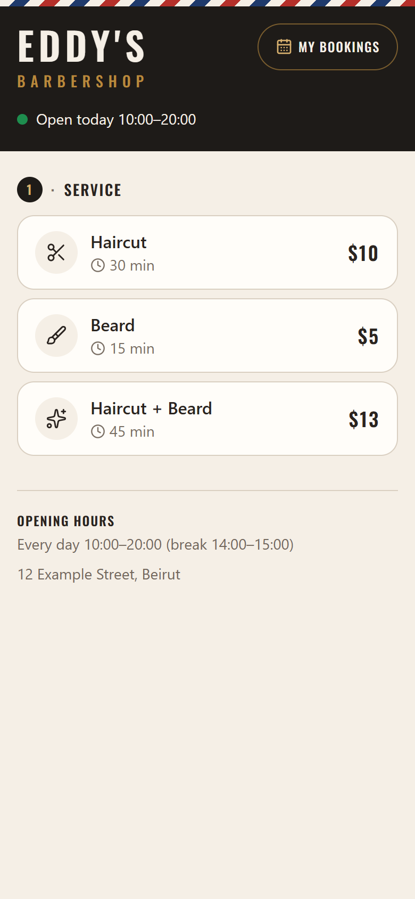
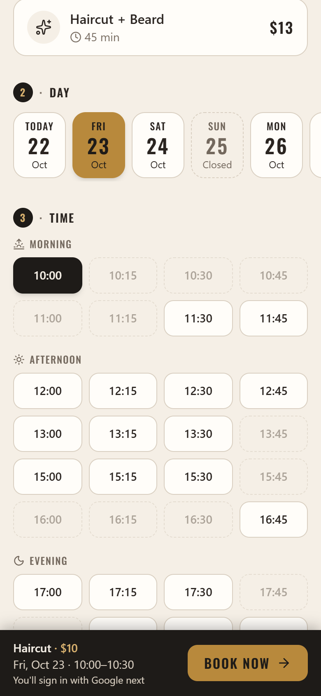
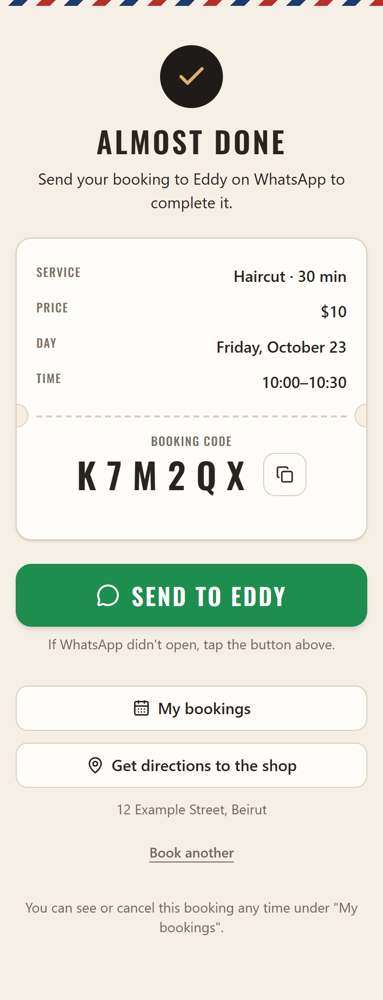

# Eddy's Barbershop — Online Booking

A real booking system built for a working one-chair barbershop in Zgharta. Customers pick a
service, a day and a free time on their phone, sign in with Google, and send the booking to the
barber on WhatsApp; the barber runs his day from a mobile dashboard: who's up next, walk-ins,
opening hours, prices and days off. Every rule (no double bookings, opening hours, booking
limits) is enforced on the server by Firestore security rules, not just in the browser.

**Live:** [eddy-barbershop.web.app](https://eddy-barbershop.web.app)

## Screenshots

<p>
  
  
  
</p>

<!-- Barber's dashboard:
<p>
  
  
  
  
</p>
-->

## Features

**For customers**

- Services with duration and price, days within the booking window (closed days shown but not
  selectable), and start times grouped by morning, afternoon and evening.
- Live availability: times update in real time as other people book, and times that don't
  leave enough room for the chosen service are faded out.
- Google sign-in, then name and phone (remembered for next time).
- A confirmation "ticket" with a booking code, a pre-filled WhatsApp message to the barber, and
  directions to the shop.
- "My bookings" to see past and upcoming bookings and cancel before the appointment.

**For the barber**

- A "Today" dashboard: bookings, done and free-slot counts, the next customer with one-tap
  Done / No-show, call and WhatsApp links, and the rest of the day including breaks and blocked
  times.
- A calendar view of any day, and walk-in or phone bookings that go through the same
  double-booking checks as online ones.
- Settings: weekly hours with breaks, services with prices, booking window, holiday periods with
  a longer window, days off, blocked times, shop address and Maps link. Changes show up live on
  the booking page, and bookings that would clash with new hours are listed for him to handle;
  nothing is ever cancelled automatically.

## Tech stack

- **Frontend:** React, TypeScript, Vite, Tailwind CSS (mobile-first), lucide icons, self-hosted
  Oswald font
- **Backend:** Firebase: Cloud Firestore (real-time data + security rules), Authentication
  (Google for customers, email/password for the barber), Hosting, App Check (reCAPTCHA
  Enterprise)
- **Testing:** Vitest, Firebase Local Emulator Suite, `@firebase/rules-unit-testing`

## How it works

**No double bookings, even under concurrent requests.** The day is a grid of 15-minute slots,
and every taken slot is its own Firestore document (`slots/{date}_{HHMM}`). A booking is one
transaction that creates the booking and every slot document it covers. The rules only allow
slots to be *created*, never overwritten, so if two people grab the same time at once, one
transaction fails and nothing partial is written. Times the barber blocks are slot documents too.

**All rules enforced server-side.** The page checks everything for a good experience, but the
Firestore security rules are what count. A customer booking must match the current settings:
an existing service with its exact name and length, within that weekday's hours, clear of
breaks and days off, in the future, inside the booking window (or a holiday period's), with
only the expected fields. Customers can only see their own bookings, and cancel them only before
they start. Saved customer details are readable only by their owner and the barber.

**Rules tuned to Firestore's limits.** Firestore stops evaluating a write after 1,000
expressions and 10 document reads, and a customer booking is the heaviest write. Settings are
stored in the shape that's cheapest to check (times as minutes, dates as day numbers, services
as a map keyed by ID), and shared values are computed once and passed down. A test builds the
worst-case booking and also re-runs it against padded copies of the rules, to prove it keeps
about 15% of the expression budget spare.

**Google sign-in with per-account limits.** Each Google account and each phone number can hold
at most 2 upcoming bookings, enforced with "seat" documents the rules check in the same
transaction, so the calendar can't be filled from one account. The barber's account is a
separate email/password login, and admin rights require both his account ID and that sign-in
method.

**Hardened hosting.** A strict Content-Security-Policy (only the site's own scripts plus Google
sign-in and reCAPTCHA), HSTS, `frame-ancestors` / X-Frame-Options, `nosniff`, Referrer-Policy
and Permissions-Policy, set in `firebase.json`. App Check limits the database to the real
website, and user-provided links (the Maps link) must be `https://`.

**Time zones.** Bookings are in the shop's time (Asia/Beirut, with daylight saving), whatever
the visitor's device says, and the rules check each booking's start instant against it.

## Testing

```bash
npm test             # Vitest: slot grid, availability, schedule, time zone and phone logic
npm run test:rules   # Firestore rules + data layer against the emulator (needs Java 21+)
```

The rules suite (150+ tests) covers double booking, overlapping times, booking limits,
cancelling, every settings check, who can read what, and the rules-limit margins above.

## Running locally

Requirements: Node.js 22+, the [Firebase CLI](https://firebase.google.com/docs/cli)
(`npm i -g firebase-tools`), and Java 21+ for the emulator.

1. Create a Firebase project with Firestore, and enable **Google** and **Email/Password**
   sign-in under Authentication.
2. Copy `.env.example` to `.env.local` and fill in your project's web app config and the
   barber's WhatsApp number (`.env.local` is git-ignored). For production builds, also set
   `VITE_FIREBASE_AUTH_DOMAIN` in `.env.production` to the domain you host the site on.
3. Create the barber's email/password user and put its UID in `ADMIN_UID` in `src/config.ts`
   and in `isAdmin()` in `firestore.rules`.
4. Install and run:

   ```bash
   npm install
   firebase use --add            # pick your project
   firebase deploy --only firestore:rules
   npm run dev                   # http://localhost:5173
   ```

5. Sign in at `/admin` once: that creates the default settings, and the booking page opens.

App Check is optional and off until `VITE_RECAPTCHA_ENTERPRISE_KEY` is set. Setup, deployment
and the details of every rule are in [docs/DEVELOPMENT.md](docs/DEVELOPMENT.md).

## License

[MIT](LICENSE)
